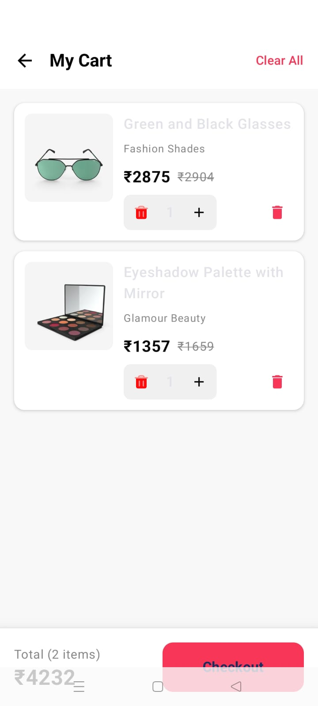
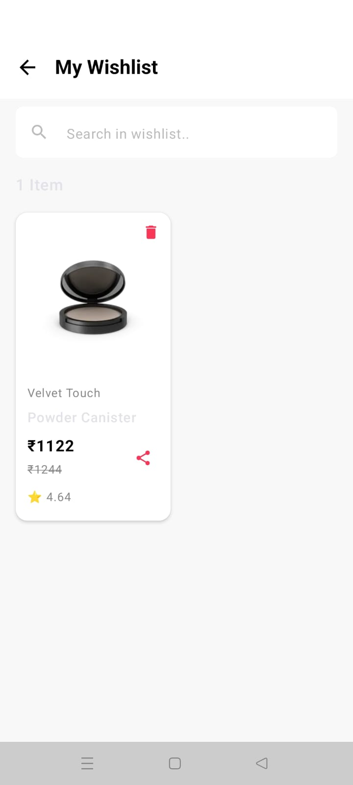

# 🌿 EcoMart – Modern Android E-Commerce App

EcoMart is a modern Android E-Commerce application built using **Kotlin** and **Jetpack Compose** following **Clean Architecture principles**.
The app provides a smooth and modern shopping experience while maintaining scalable and maintainable code architecture.

The project is divided into **Data, Domain, and Presentation layers** to ensure proper separation of concerns.

---

# 🚀 Features

🛍 Browse Products
🔍 Search Products
🛒 Add to Cart
❤️ Wishlist Management
👤 User Authentication
📦 Product Details
⚙️ Settings Management
📱 Modern UI with Jetpack Compose
⚡ Smooth Navigation between Screens
🎬 Onboarding Experience
🔐 User Preferences Storage

---

# 🛠 Tech Stack

* **Kotlin**
* **Jetpack Compose**
* **Material Design 3**
* **Clean Architecture**
* **MVVM Architecture**
* **Navigation Component**
* **Dependency Injection**
* **Android Studio**

---

# 🧠 Architecture Overview

This project follows **Clean Architecture**, which separates the app into different layers:

* **Data Layer** → Handles API, database, and repositories
* **Domain Layer** → Contains business logic and use cases
* **Presentation Layer** → Handles UI and user interaction

This architecture improves **testability, scalability, and maintainability**.

---

# 📂 Project Structure

```
com.store.stylish
│
├── data
│   ├── dto
│   ├── local
│   ├── remote
│   ├── repository
│   └── repositoryimpl
│
├── domain
│   ├── model
│   ├── repository
│   ├── usecase
│   └── util
│
├── di
│
├── Navigation
│   ├── AppNavigation.kt
│   └── Routes.kt
│
├── Presentation
│   ├── Auth
│   ├── Cart
│   ├── Components
│   ├── OnboardingScreen
│   ├── Products
│   ├── Search
│   ├── Settings
│   ├── Splash
│   ├── UserPreferences
│   └── Wishlist
│
├── services
│
├── ui.theme
│
├── utils
│
├── EcoMartApplication.kt
└── MainActivity.kt
```

---

# 📸 App Screenshots

(Add your screenshots here)

### Home Screen


### Product Screen


### Cart Screen



### Wishlist Screen



---

# ▶️ How to Run the Project

1️⃣ Clone the repository

```
git clone https://github.com/yourusername/EcoMart-Android.git
```

2️⃣ Open the project in **Android Studio**

3️⃣ Sync Gradle

4️⃣ Run the application on an **Android Emulator or Physical Device**

---

# 🔮 Future Improvements

* Online Payment Integration
* Order Tracking
* Push Notifications
* Product Reviews & Ratings
* Dark Mode Support

---

# 👨‍💻 Author

**Adi Jain**

Android Developer | Kotlin | Jetpack Compose

---

# ⭐ Support

If you like this project, please give it a **Star ⭐ on GitHub**.
